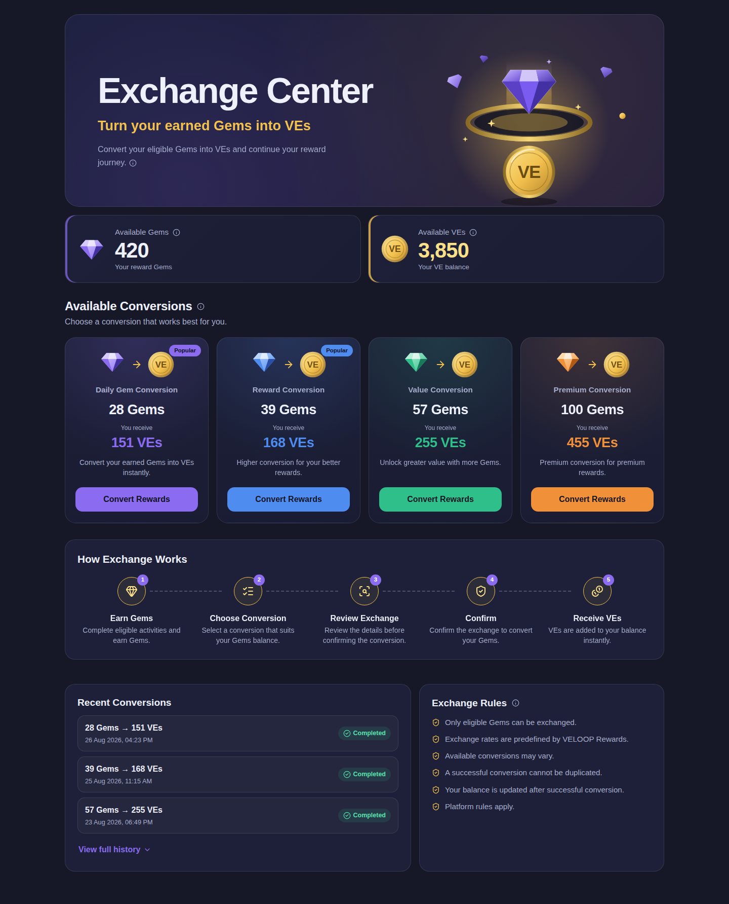

# VELOOP Rewards — Exchange Center

A frontend redesign of the VELOOP Rewards **Exchange Center**, where users convert earned **Gems** into **VEs** through predefined reward conversions. It is a reward conversion experience, not a crypto swap: there are no prices, charts or trading controls.

**Live demo:** (https://veloopexchangecenter.vercel.app/)



## Exchange Center Concept

A "reward vault": a violet Gem drops through a golden ring and comes out as a VE coin. Every conversion card repeats that story (Gem → arrow → VE coin), so the meaning is clear at a glance: _I'm converting rewards I've earned into VEs._ Palette: deep navy on the `#161827` app background, gold, controlled violet and silver.

## Features

- Hero, balance overview (Gems and VEs) and four conversion cards
- Insufficient Gems state: shows how many more Gems are needed and swaps the CTA to **Earn More Gems**
- Confirmation modal with balances after conversion, keyboard accessible (Esc, focus trap, focus restore)
- Double-click protection: **Converting...** with the buttons disabled until the operation ends
- Animated success state, count-up balance update and history that updates immediately
- Recent Conversions with Completed / Processing / Failed statuses
- How Exchange Works, Exchange Rules and ⓘ info tips (Gems, VEs, conversions, rules)
- Themed loader, empty state and error state with retry
- Responsive from 320px to 1920px+, with `prefers-reduced-motion` respected

## Exchange Logic

Values live in `src/data/exchangeData.js`, never in JSX.

| Conversion           | Required Gems | VEs received |
| -------------------- | ------------- | ------------ |
| Daily Gem Conversion | 28            | 151          |
| Reward Conversion    | 39            | 168          |
| Value Conversion     | 57            | 255          |
| Premium Conversion   | 100           | 455          |

Dummy balances: 420 Gems, 3,850 VEs. Conversion is allowed only if `gems >= requiredGems`. On success, Gems decrease and VEs increase by the conversion values. **Verify these against the live page before submission.**

## User Flow

Earn Gems → Choose conversion → Review in modal → Confirm → Receive VEs.

## Components

`src/components/exchange/`: `ExchangeHero`, `BalanceOverview`, `ExchangeCard`, `ExchangeModal`, `ConversionSuccess`, `ExchangeHistory`, `ExchangeRules`, `HowExchangeWorks`, `ExchangeLoader`, `ExchangeState` (empty/error), plus `InfoTip`, `AnimatedNumber`, `RewardIcons`. Page: `src/pages/ExchangeCenter/ExchangeCenter.jsx`.

## Technology Stack

React 19, Vite, Bootstrap 5 (grid), CSS Modules, React Hooks, Lucide React, Framer Motion.

## Installation

```bash
npm install
```

## Local Development

```bash
npm run dev
```

Preview states with a URL parameter: `/?demo=loading`, `/?demo=error` (succeeds on Retry), `/?demo=empty`, `/?demo=low-gems`.

## Build Instructions

```bash
npm run build
npm run preview
```

## Responsive Design

Mobile-first. Cards stack on mobile, 2 columns on tablet (`md`) and 4 on desktop (`xl`). Content is capped at 1240px so large screens stay balanced. The How It Works steps run vertically on mobile and horizontally on desktop.

## Animation System

Framer Motion handles entrances, hover lift, modal transitions and the success burst. CSS keyframes handle the floating Gems and the loader. All motion is transform/opacity based and disabled for users who prefer reduced motion.

## Future Backend Integration

Replace `fetchExchangeData` and `submitConversion` in `src/data/exchangeData.js` with API calls; components only depend on the returned shapes. When integrating:

- Let the server decide eligibility, unlock times and balances. Never trust the device clock.
- Validate the balance server-side and make each conversion idempotent (one-time conversion ID) so it cannot be duplicated.
- Return the updated balance and history from the API.

## Deployment

Push to GitHub, then import the repo in Vercel or Netlify. Build command `npm run build`, output directory `dist`.
